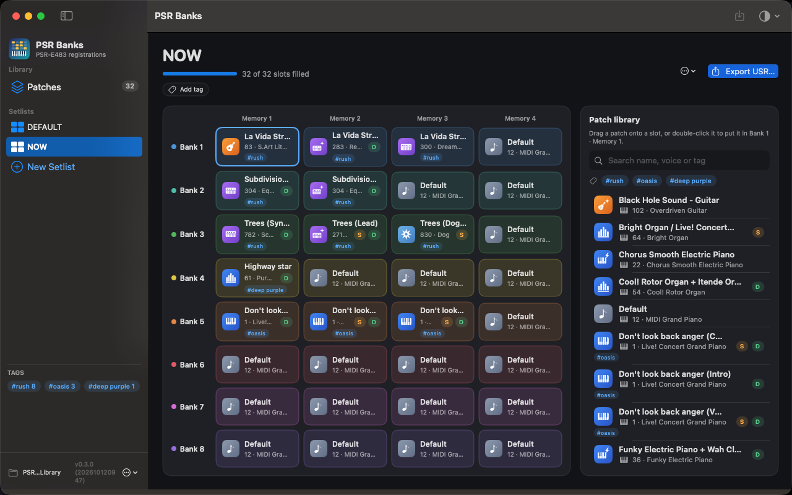
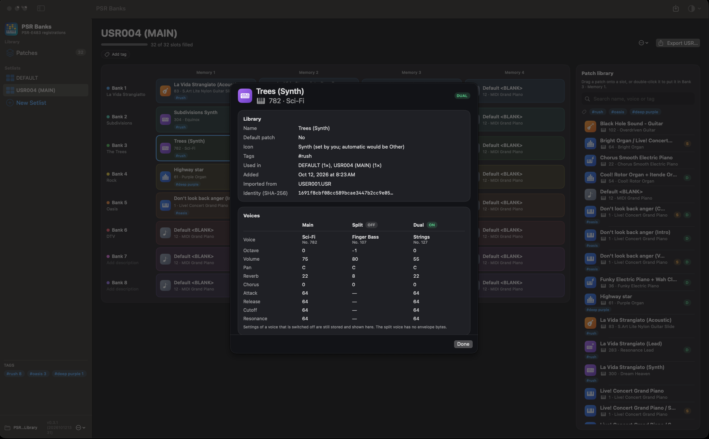
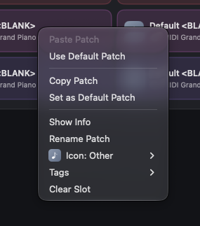

# PSR Banks

macOS app to keep a library of PSR-E483 registration patches and assemble/export them as `.USR` setlists.

## Features

- Patch library: import `.USR` files, then name, tag, pick an instrument icon for and inspect each patch.
- Setlists of 8 banks × 4 memories, built by drag and drop, copy/cut/paste, or a default patch.
- Bank descriptions: a short phrase per bank (e.g. "Salsa", "Song SBC"), edited under the bank name. They are kept in
  the app only, not written to the exported `.USR`. A label is remembered for the bank's four patches, so importing
  the same bank again restores it.
- Export a valid `USER00x.USR` file for the keyboard.

| Patch info | Slot menu |
| --- | --- |
|  |  |

## Install

    brew install --cask sergiorivas/tap/psr-banks

The build is ad-hoc signed (not notarized); the cask strips the quarantine flag. If macOS still refuses to open it:
`xattr -cr "/Applications/PSR Banks.app"`.

Example `.USR` files from a PSR-E483 are in `Examples/` (used by the tests). Landing page: https://sergiorivas.github.io/psr-banks/

## Develop

    swift test               # core logic, incl. byte-identical import → export of the example files
    Scripts/build_app.sh --open    # builds "PSR Banks.app" and launches it

Library folder defaults to `~/Documents/PSR Banks Library` (change it from the "…" menu in the sidebar).

## Release

Commit, then run `Scripts/publish_cask.sh [version]`. The version defaults to the next patch after the latest `vX.Y.Z`
tag (`Scripts/version.sh`); pass one to override it, and add a matching `## X.Y.Z` section to `CHANGELOG.md` for the
release notes. It runs the tests, builds and zips the
app, tags `vX.Y.Z`, creates the GitHub release and updates the cask in the `homebrew-tap` repo.
